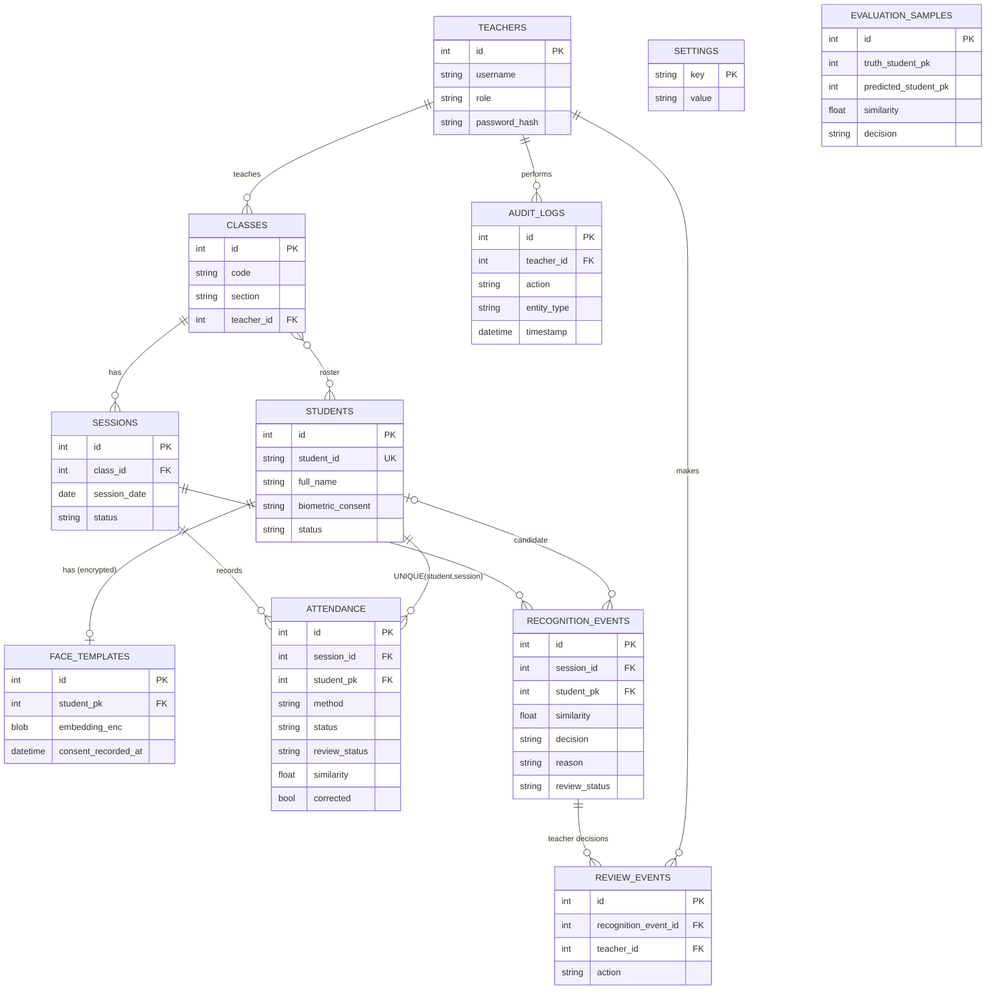

# Architecture

```
Browser (HTML/CSS/JS modules)  --JSON/JPEG over HTTP-->  FastAPI routers (app/routers)
   webcam via getUserMedia                                   |  validation, authz, HTTP codes
                                                             v
                                            services (app/services): attendance, recognition, trustscore, settings
                                                             |
                               cv/service.py (OpenCV YuNet + SFace)      SQLAlchemy models -> SQLite (data/attendeye.db)
```

- **Frontend never touches SQLite**; it only calls `/api/*` (see `API.md`).
- **One place creates attendance:** `services/attendance.py::record_attendance` (used by face, review-confirm and manual). It re-checks session active + student active; the `UNIQUE(student_pk, session_id)` constraint is the final duplicate guard, also under concurrent requests (tested).
- **Decision pipeline (live frame):** detect (YuNet) -> quality gate -> align + embed (SFace) -> cosine match against encrypted templates -> TrustScore policy -> session rules (roster, duplicate, consecutive frames) -> record / open review case / ignore.

## Database ER diagram



## Reading the numbers (important for judges)

| Term | Meaning here |
|---|---|
| **Similarity score** | Cosine similarity of two 128-d SFace embeddings (-1..1). A distance-style score. **Not** a probability. |
| **Calibrated probability** | "If the system says 90 %, it is right 90 % of the time." AttendEye does **not** produce this; we show no confidence percentages. |
| **Measured accuracy** | False-accept / false-reject counts from labelled captures on *this* installation (System Evaluation page). Only valid for the conditions and people tested. |

TrustScore describes how reliable one *recognition decision* is. It says nothing about a person.

## Schema changes
`init_db()` uses `create_all`, which creates missing tables but does not alter existing ones. This version added **no** columns. If a future change needs one, take a copy of `data/attendeye.db`, add the column with `ALTER TABLE ... ADD COLUMN`, and run the tests before deleting the copy.
